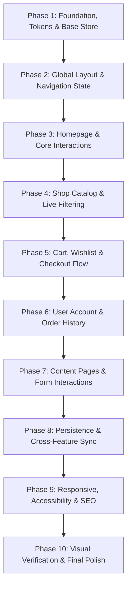

# Ecobazar - Organic eCommerce Website: Single Source of Truth Design Document

> **Document Status**: Draft for User Review & Approval  
> **Source Design**: [Ecobazar - Organic eCommerce Shop Website (Figma File fus5sbNQC0Iu3Q42bt5tN0)](https://www.figma.com/design/fus5sbNQC0Iu3Q42bt5tN0/Ecobazar---Organic-eCommerce-Shop-Website--Community---Copy---Copy---Copy---Copy-?node-id=460-39913)  
> **Target Framework**: Next.js 16.4.0 (App Router) • React 19.3.0 • TypeScript 5 • Tailwind CSS v4 • Redux Toolkit  

---

## 1. Specification Status Legend

To ensure complete transparency and eliminate ambiguity, every detail throughout this document is explicitly labeled using one of the following tags:

* **`[Confirmed from Figma]`**: Extracted directly from the Figma file (`Style Guide`, `Main Components`, or `➡️ Website` frames).
* **`[Inferred Implementation Detail]`**: Necessary technical decision for implementation in Next.js/React that is not explicitly defined in static Figma frames (e.g., responsive breakpoint behavior for screens without dedicated mobile artboards, state slice structures, accessible ARIA attributes).
* **`[Requires Clarification]`**: Ambiguous requirement or open product decision where user direction is needed.

---

## 2. Current Project State vs. Proposed New Resources

### 2.1 Existing Project Environment (Inspected & Verified)
* **Framework**: Next.js `16.4.0` (App Router) running with Turbopack (`next dev`).
* **Core Libraries**: React `19.3.0`, React DOM `19.3.0`.
* **Styling**: Tailwind CSS `^4.0.0` with `@tailwindcss/turbopack` and standard `@import "tailwindcss";` in `app/globals.css`.
* **TypeScript**: TypeScript `^5.0.0` with strict compiler flags (`strict: true`, path alias `@/*` mapped to `./*`).
* **Existing Project Files**:
  * `app/layout.tsx`: Starter RootLayout using Geist fonts.
  * `app/page.tsx`: Clean blank component placeholder.
  * `app/globals.css`: Base Tailwind CSS v4 imports.
  * `public/`: Default starter SVGs (`file.svg`, `globe.svg`, `next.svg`, `vercel.svg`, `window.svg`).
  * `package.json`, `tsconfig.json`, `next.config.ts`.
  * `scripts/fetch-figma.mjs`: Utility script used for Figma API queries.
  * `.agents/mcp_config.json`: Figma MCP server configuration.

### 2.2 Proposed Dependencies to Install in Phase 1 `[Inferred Implementation Detail]`
*(None of these are currently installed; they will only be installed upon user approval of Phase 1)*:
1. **`@reduxjs/toolkit`** & **`react-redux`**: For global client state (Cart, Wishlist, Filter state, UI modals).
2. **`lucide-react`**: For standard icons matching Figma designs (search, cart, heart, star, eye, user, chevron, phone, check, etc.).

### 2.3 Proposed Directory Structure (To Be Created During Implementation) `[Inferred Implementation Detail]`
```text
c:\Users\HP\Desktop\ecom\
├── app/                        # Next.js App Router (Existing folder, routes to be added)
│   ├── layout.tsx              # RootLayout (To update with Poppins/Inter and Redux Provider)
│   ├── page.tsx                # Homepage (01_Homepage)
│   ├── shop/
│   │   ├── page.tsx            # Shop catalog (07_Shop 1)
│   │   └── [id]/page.tsx       # Product detail (10_Products_Details_Description)
│   ├── cart/page.tsx           # Cart page (15_Shopping_Cart)
│   ├── checkout/page.tsx       # Checkout page (16_Checkout)
│   ├── wishlist/page.tsx       # Wishlist page
│   ├── account/
│   │   ├── dashboard/page.tsx  # User Dashboard (23_User_Dashboard)
│   │   ├── orders/page.tsx     # Order History (24_Order_History)
│   │   ├── orders/[id]/page.tsx# Order Details (25_Order_Details)
│   │   └── settings/page.tsx   # Account Settings (26_Settings)
│   ├── blog/
│   │   ├── page.tsx            # Blog List (17_Blog_List)
│   │   └── [slug]/page.tsx     # Single Blog (18_Single_Blog)
│   ├── about/page.tsx          # About Us (19_About)
│   ├── contact/page.tsx        # Contact Us (20_Contact)
│   ├── faqs/page.tsx           # FAQs (27_FAQs)
│   ├── sign-in/page.tsx        # Sign In (21_Sign_In)
│   ├── create-account/page.tsx # Create Account (22_Create_Account)
│   └── not-found.tsx           # 404 Error (28_404 Error Page)
├── components/                 # UI components (To be created)
│   ├── common/                 # Primitives (Button, Input, Badge, RatingStars, Stepper, Modal)
│   ├── layout/                 # TopBar, MiddleBar, MainNavigation, CategoryDrawer, Footer, CartFlyout
│   ├── product/                # ProductCard, ProductDealCard, ProductQuickViewModal
│   ├── home/                   # HeroSlider, FeaturesBar, PromoBanners, CategoriesGrid, HotDeals, etc.
│   ├── shop/                   # FilterSidebar, PriceSlider, RatingFilter, ShopToolbar
│   ├── cart/                   # CartTable, CartRow, CouponForm, CartTotals
│   ├── checkout/               # BillingForm, PaymentMethodPicker, OrderSummaryCard
│   ├── dashboard/              # DashboardSidebar, OrderTracker, OrderTable, AddressCard
│   └── blog/                   # BlogCard, BlogSidebar, BlogCommentForm
├── store/                      # Redux Toolkit state (To be created)
│   ├── index.ts                # Store config
│   ├── hooks.ts                # Typed useAppDispatch, useAppSelector
│   └── slices/                 # cartSlice, wishlistSlice, filterSlice, uiSlice
├── types/                      # TypeScript contracts (To be created)
│   └── index.ts                # Product, Category, CartItem, Order, FilterState
├── data/                       # Mock data repositories (To be created)
│   ├── products.ts
│   ├── categories.ts
│   ├── testimonials.ts
│   └── blogPosts.ts
├── lib/                        # Helpers (To be created)
│   └── utils.ts                # cn (clsx + twMerge), formatCurrency, formatDate
└── public/
    └── images/                 # Downloaded / extracted Figma assets (To be created)
```

---

## 3. Figma Design Analysis & Tokens

### 3.1 Canvases in Figma `[Confirmed from Figma]`
1. **`ℹ️ Info`** (`id: 1:4`): Project licensing and font details.
2. **`🎨 Style Guide`** (`id: 674:53788`): Design tokens, complete typography system, color ramps, header and footer specifications.
3. **`⚙️ Main Components`** (`id: 9:53`): 100+ master UI components, interactive variants, buttons, inputs, product cards, banners, and modals.
4. **`➡️ Website`** (`id: 460:39913`): 28 complete screen designs.

---

### 3.2 Complete Breakdown of All 28 Figma Pages `[Confirmed from Figma]`

| Frame Name in Figma | Canvas Dimensions | Type | Confirmed Sections & Contents |
| :--- | :--- | :--- | :--- |
| `01_Homepage` | 1920 × 7174 px | Page | Topbar (42px), MiddleBar (93px), MainNavigation (60px), Hero Slider (536px), 4 Value Props (128px), 3 Promo Banners (600px), Popular Categories (520px), Hot Deals with Timer (714px), Popular Products 5-col tabs (1171px), Discount Banner (358px), Featured Products 4-col (397px), Latest News blog cards (564px), Client Testimonials (451px), Brand Logos Marquee (152px), Instagram Gallery (270px), Footer (530px). |
| `02_Homepage_Box_Layout` | 1920 × 7174 px | Page | Same sections as `01_Homepage`, framed within a 1400px bordered boxed container. |
| `03_Homepage` | 1920 × 6850 px | Page | Variant 3 with alternative hero slider layout and banner arrangement. |
| `04_Homepage` | 1920 × 6720 px | Page | Variant 4 with persistent category sidebar navigation next to hero slider. |
| `05_Homepage` | 1920 × 6590 px | Page | Variant 5 with modern card layouts and alternative banner placements. |
| `06_Newsletter_Popup` | 900 × 520 px | Modal | Centered lightbox popup with 20% discount offer, email input, subscribe button, "Do not show again" checkbox. |
| `07_Shop 1` | 1920 × 2640 px | Page | Breadcrumbs, left filter sidebar (Categories, Price Slider, Rating, Tags, Stock Status), top sorting bar (Sort By, Count, View Mode), 4-column product grid (12 products/page), pagination. |
| `08_Shop 2` | 1920 × 2480 px | Page | Shop layout variant with top horizontal filter bar or promotional banner header. |
| `09_Product_Quick View` | 960 × 600 px | Modal | Lightbox modal: Image gallery, title, rating, stock status, price, short description, quantity stepper, Add to Cart, Add to Wishlist, meta tags. |
| `10_Products_Details_Description` | 1920 × 2450 px | Page | Product page: Gallery thumbnails, buy-box, tab strip with active "Description" tab, related products carousel. |
| `11_Products_Details_Additional Info` | 1920 × 2380 px | Page | Product page with active "Additional Information" tab displaying technical specifications table (weight, color, type, packaging). |
| `12_Product_Detail_Customer_Feedback` | 1920 × 2720 px | Page | Product page with active "Customer Feedback & Reviews" tab, rating breakdown bars, reviews list, and review submission form. |
| `13_Shopping_Card_Popup` | 440 × 1080 px | Flyout | Mini-cart drawer sliding in from the right: Cart items with thumbnails, quantity, subtotal, "View Cart", and "Checkout" CTAs. |
| `15_Shopping_Cart` | 1920 × 1420 px | Page | Breadcrumbs, Cart table (Product, Price, Quantity Stepper, Subtotal, Remove icon), Coupon code form, Cart Totals summary box with Shipping estimator, "Proceed to Checkout" button. |
| `16_Checkout` | 1920 × 1680 px | Page | Two-column checkout: Billing Information form, "Ship to different address" checkbox, Order Notes, Order Summary card, Payment method selector (Cash on Delivery, PayPal, Credit Card), "Place Order" CTA. |
| `17_Blog_List` | 1920 × 2340 px | Page | Blog archive with cards (image, date badge, author, title, snippet, read more) + sidebar (Search, Categories, Recent Posts, Popular Tags), pagination. |
| `18_Single_Blog` | 1920 × 2960 px | Page | Article view: Header image, full copy, author bio box, social share buttons, previous/next post links, comments feed, leave-a-comment form. |
| `19_About` | 1920 × 3120 px | Page | Company story ("100% Trusted Organic Food Store"), feature cards, team member cards with social icons, client testimonials, partner brand logos. |
| `20_Contact` | 1920 × 1760 px | Page | 3 contact cards (Address, Phone, Email), interactive contact inquiry form, embedded Google map placeholder. |
| `21_Sign_In` | 1920 × 1180 px | Page | Centered card: Email, Password, Remember Me checkbox, Forgot Password link, Login button, "Don't have account? Register" link. |
| `22_Create_Account` | 1920 × 1240 px | Page | Centered card: Email, Password, Confirm Password, Accept Terms & Conditions checkbox, Register button, "Already have account? Login" link. |
| `23_User_Dashboard` | 1920 × 1540 px | Page | Account layout with sidebar menu, welcome card with avatar, recent order overview table, default billing and shipping address cards. |
| `24_Order_History` | 1920 × 1460 px | Page | Order history table: Order ID, Date, Total, Status badge (Processing, Completed, Cancelled), Action link ("View Details"), pagination. |
| `25_Order_Details` | 1920 × 1620 px | Page | Detailed order view: 4-stage visual progress stepper (Order Received ➔ Processing ➔ On the road ➔ Delivered), ordered item list, shipping and billing summary. |
| `26_Settings` | 1920 × 1580 px | Page | Account settings tabs: Profile Settings (Name, Email, Phone), Change Password, Billing Address update form. |
| `27_FAQs` | 1920 × 1720 px | Page | FAQ accordion items grouped by topic, search input, "Still have questions?" support card. |
| `28_404 Error Page` | 1920 × 1140 px | Page | Centered illustration, "Oops! Page not found" headline, supportive message, "Back to Home" primary button. |

---

### 3.3 Layout, Spacing & Dimensions

| Parameter | Value | Status | Implementation Detail |
| :--- | :--- | :--- | :--- |
| **Desktop Canvas Width** | `1920px` | `[Confirmed from Figma]` | Base design viewport width |
| **Max Container Width** | `1320px` | `[Confirmed from Figma]` | Standard Tailwind container: `max-w-[1320px] mx-auto px-4 sm:px-6 lg:px-8` |
| **Boxed Layout Width** | `1400px` | `[Confirmed from Figma]` | Container for `02_Homepage_Box_Layout`: `max-w-[1400px] border shadow-sm` |
| **Grid System** | 12 columns, `24px` gutter | `[Confirmed from Figma]` | Tailwind `grid grid-cols-12 gap-6` |
| **Top Bar Height** | `42px` | `[Confirmed from Figma]` | Currency/language selector, store notice, sign-in link |
| **Middle Bar Height** | `93px` | `[Confirmed from Figma]` | Logo, search input with category dropdown, wishlist, cart |
| **Main Nav Height** | `60px` | `[Confirmed from Figma]` | All Categories dropdown, nav links, support phone line |
| **Section Spacing** | `60px` – `100px` | `[Confirmed from Figma]` | Desktop vertical padding: `py-16` to `py-24` |
| **Product Card Padding**| `16px` – `20px` | `[Confirmed from Figma]` | Inner card padding: `p-4` or `p-5` |
| **Border Radius** | Badges: Full (`9999px`)<br>Buttons/Inputs/Cards: `6px`–`8px` | `[Confirmed from Figma]` | `rounded-full`, `rounded-md` (`6px`), `rounded-lg` (`8px`) |
| **Tablet Breakpoint** | `768px – 1023px` | `[Inferred Implementation Detail]` | 3-column product grid; sidebar filter in drawer modal |
| **Mobile Breakpoint** | `< 768px` | `[Inferred Implementation Detail]` | 2-column or 1-column product cards; sticky bottom navigation |

---

### 3.4 Typography Scale `[Confirmed from Figma]`

* **Primary Font Family**: **`Poppins`** (Google Font, sans-serif) — Headers, navigation, titles, buttons.
* **Secondary Font Family**: **`Inter`** (Google Font, sans-serif) — Body text, tables, forms, metadata.

| Token | Size | Line Height | Font Weights | Usage in Design | Status |
| :--- | :--- | :--- | :--- | :--- | :--- |
| **Display 01** | `72px` | `1.2` (86px) | Regular (400), SemiBold (600) | Hero banner discount headlines | `[Confirmed from Figma]` |
| **Heading 01** | `56px` | `1.2` (67px) | Regular (400), SemiBold (600) | Major page banners & marketing promos | `[Confirmed from Figma]` |
| **Heading 02** | `48px` | `1.2` (58px) | Regular (400), SemiBold (600) | Section headlines (e.g. Popular Categories) | `[Confirmed from Figma]` |
| **Heading 03** | `40px` | `1.2` (48px) | Regular (400), SemiBold (600) | Product detail title, about headlines | `[Confirmed from Figma]` |
| **Heading 04** | `36px` | `1.2` (43px) | Regular (400), SemiBold (600) | Card group headers, newsletter title | `[Confirmed from Figma]` |
| **Heading 05** | `32px` | `1.2` (38px) | Regular (400), SemiBold (600) | Deals headline, modal headers | `[Confirmed from Figma]` |
| **Body XXL** | `24px` | `1.5` (36px) | Regular (400), Medium (500) | Subtitles, cart totals, deal timer digits | `[Confirmed from Figma]` |
| **Body XL** | `20px` | `1.5` (30px) | Regular (400), Medium (500) | Large product card titles | `[Confirmed from Figma]` |
| **Body Large** | `18px` | `1.5` (27px) | Regular (400), Medium (500) | Standard product card titles, promo text | `[Confirmed from Figma]` |
| **Body Medium**| `16px` | `1.5` (24px) | Regular (400), Medium (500) | Base body copy, input text, table cells | `[Confirmed from Figma]` |
| **Body Small** | `14px` | `1.5` (21px) | Regular (400), Medium (500) | Breadcrumbs, navigation links, buttons | `[Confirmed from Figma]` |
| **Body Tiny** | `12px` | `1.5` (18px) | Regular (400), Medium (500) | Badges, discount tags, meta dates, SKU | `[Confirmed from Figma]` |

---

### 3.5 Color Palette & Tokens `[Confirmed from Figma]`

| Token Name | Hex Code | Figma Role | Status |
| :--- | :--- | :--- | :--- |
| **`primary`** | `#00B207` | Brand Signature Green (Main CTA, active nav, checkboxes, primary badges) | `[Confirmed from Figma]` |
| **`primary-hover`** | `#2C742F` | Primary button hover & active state | `[Confirmed from Figma]` |
| **`primary-light`** | `#84D187` | Accent borders, soft icons | `[Confirmed from Figma]` |
| **`primary-tint`** | `#EDF2EE` | Soft green background for category icons & cards | `[Confirmed from Figma]` |
| **`primary-soft`** | `#DAE5DA` | Alternative soft green border / tag fill | `[Confirmed from Figma]` |
| **`primary-hard`** | `#002603` | Deep dark green used on select promotional banner backings | `[Confirmed from Figma]` |
| **`accent-orange`** | `#FF8A00` | Warning, star reviews, deal countdown badges | `[Confirmed from Figma]` |
| **`danger` / `sale`** | `#EA4B48` | Sale ribbons ("Sale 50%"), out-of-stock badge, form error state | `[Confirmed from Figma]` |
| **`dark-navy`** | `#0A1931` | Banner accents & dark surfaces | `[Confirmed from Figma]` |
| **`gray-900`** | `#1A1A1A` | Highest-contrast typography, main headings, top navbar background | `[Confirmed from Figma]` |
| **`gray-800`** | `#333333` | Subheadings, card titles | `[Confirmed from Figma]` |
| **`gray-700`** | `#4D4D4D` | Navigation links, secondary labels | `[Confirmed from Figma]` |
| **`gray-600`** | `#666666` | Standard body paragraphs, product descriptions | `[Confirmed from Figma]` |
| **`gray-500`** | `#808080` | Muted metadata, timestamp, secondary icons | `[Confirmed from Figma]` |
| **`gray-400`** | `#999999` | Form placeholders, disabled labels | `[Confirmed from Figma]` |
| **`gray-300`** | `#B3B3B3` | Inactive stepper controls, subtle dividers | `[Confirmed from Figma]` |
| **`gray-200`** | `#CCCCCC` | Borders for cards, inputs, and tables | `[Confirmed from Figma]` |
| **`gray-100`** | `#E5E5E5` | Dividers, background card borders | `[Confirmed from Figma]` |
| **`gray-50`** | `#F2F2F2` | Subtle section backgrounds, table headers | `[Confirmed from Figma]` |
| **`white`** | `#FFFFFF` | Primary surface backgrounds, card fills | `[Confirmed from Figma]` |

---

### 3.6 Elevation & Shadows `[Confirmed from Figma / Inferred Implementation Detail]`
* **`shadow-card`**: `0 0 12px rgba(0, 0, 0, 0.08)` `[Confirmed from Figma]` (Product card base)
* **`shadow-card-hover`**: `0 8px 24px rgba(0, 178, 7, 0.15)` `[Inferred Implementation Detail]` (Green glow on hover)
* **`shadow-modal`**: `0 20px 48px rgba(0, 0, 0, 0.16)` `[Confirmed from Figma]` (Quick View & Newsletter popups)
* **`shadow-dropdown`**: `0 10px 30px rgba(0, 0, 0, 0.10)` `[Confirmed from Figma]` (Category menu drawer)

---

## 4. Component Architecture & Props Specifications

All components will be modular, strictly typed, and small in scope.

### 4.1 Common Primitives (`components/common/`) `[Inferred Implementation Detail]`

* **`Button.tsx`**:
  * **Props**: `variant: 'primary' | 'secondary' | 'outline' | 'ghost' | 'danger'`, `size: 'sm' | 'md' | 'lg'`, `icon?: ReactNode`, `isLoading?: boolean`, `children: ReactNode`, plus standard HTML button attributes.
* **`Input.tsx`**:
  * **Props**: `label?: string`, `error?: string`, `icon?: ReactNode`, plus standard HTML input attributes.
* **`Badge.tsx`**:
  * **Props**: `variant: 'sale' | 'new' | 'outOfStock' | 'hot'`, `label: string`.
* **`RatingStars.tsx`**:
  * **Props**: `rating: number` (0 to 5), `reviewCount?: number`, `interactive?: boolean`, `onRate?: (rating: number) => void`.
* **`QuantitySelector.tsx`**:
  * **Props**: `value: number`, `min?: number`, `max?: number`, `onChange: (val: number) => void`, `size?: 'sm' | 'md'`.
* **`Modal.tsx`**:
  * **Props**: `isOpen: boolean`, `onClose: () => void`, `title?: string`, `children: ReactNode`.

### 4.2 Layout Components (`components/layout/`) `[Inferred Implementation Detail]`

* **`TopBar.tsx`**: Store location selector, currency dropdown (USD), language dropdown (Eng), Sign In/Register links.
* **`MiddleBar.tsx`**: Ecobazar SVG logo, search bar with category filter, wishlist icon with counter, cart icon with counter and subtotal.
* **`MainNavigation.tsx`**: Category drawer trigger button ("All Categories"), primary links (Home, Shop, Pages, Blog, About Us, Contact Us), support phone hotline (`(219) 555-0114`).
* **`CategoryDrawer.tsx`**: Collapsible vertical accordion/menu displaying all organic categories.
* **`Footer.tsx`**: Multi-column links (About, My Account, Helps, Proxy), contact details, payment provider icons (Apple Pay, Visa, Mastercard, Discover), and copyright bar.
* **`CartFlyout.tsx`**: Slide-over drawer displaying active cart items, subtotal, and "View Cart" / "Checkout" navigation.

### 4.3 Product Components (`components/product/`) `[Inferred Implementation Detail]`

* **`ProductCard.tsx`**:
  * **Props**: `product: Product`, `onAddToCart: (p: Product) => void`, `onAddToWishlist: (p: Product) => void`, `onQuickView: (p: Product) => void`.
  * **Elements**: Image with zoom hover, Sale discount badge, category name, title, star rating, price (current vs original), Add to Cart button, hover action bar (Wishlist heart, Quick View eye).
* **`ProductDealCard.tsx`**:
  * **Props**: `product: Product`, `dealEndsAt: string`.
  * **Elements**: Large deal card layout with live countdown timer boxes (Days, Hours, Minutes, Seconds).
* **`ProductQuickViewModal.tsx`**:
  * **Props**: `product: Product | null`, `isOpen: boolean`, `onClose: () => void`.

---

## 5. Scope Boundaries: Authentication, Backend & Checkout

To avoid speculative features and unnecessary abstractions, the following architectural boundaries are strictly established:

1. **Backend Integration** `[Confirmed Implementation Scope]`:
   * No external database or remote API is assumed.
   * All products, categories, reviews, and blog articles are sourced from structured, strictly typed local TypeScript repositories in `@/data`.
2. **Authentication** `[Confirmed Implementation Scope]`:
   * The Figma frames `21_Sign_In` and `22_Create_Account` will be implemented as functional frontend forms.
   * Authentication state (logged-in vs guest) will be managed directly in the Redux store (`authSlice` or `uiSlice`).
   * No external auth servers (NextAuth/Auth.js/Firebase) will be introduced without an explicit user instruction.
3. **Checkout Flow** `[Confirmed Implementation Scope]`:
   * The `16_Checkout` page will validate form inputs (billing address, shipping address, payment selection).
   * Submitting the order will create an `Order` object in the Redux store (`orderHistory`), clear the cart, and navigate to an order confirmation screen.
   * No third-party payment gateways (Stripe, PayPal SDK) will be connected.

---

## 6. Assets & Media Strategy

### 6.1 Real Assets Identified in Figma `[Confirmed from Figma]`
* **Logo**: Ecobazar Brand Logo (Green sprout icon + "Ecobazar" logotype).
* **Category Icons**: Fresh Fruit (apple), Fresh Vegetables (salad), Meat & Fish (meat, fish, turkey, steak), Snacks & Bakery (cupcake, pie), Beverages (coffee).
* **Product Imagery**: Green Apple, Fresh Chinese Cabbage, Green Capsicum, Green Chilli, Red Tomatoes, Fresh Cauliflower, Big Potatoes, Chanterelle Mushrooms, Eggplant, Corn, Fresh Broccoli.
* **Promotional Banners**: Hero banner artwork, 3 Promo Banners ("Fresh & Healthy", "Summer Sale 75% OFF", "Special Deal"), full-width countdown banner.
* **Partner Brand Logos**: Steps, Mango, Food, Book-off, G-Series.
* **Payment Badges**: Apple Pay, Visa, Mastercard, Discover.

### 6.2 Asset Handling & Fallbacks `[Inferred Implementation Detail]`
* Vector icons will use `lucide-react` for crisp scaling and accessibility.
* Figma image assets will be downloaded to `public/images/` using the Figma MCP tool / REST API.
* Unsplash / SVG placeholder fallbacks matching the exact color palette and aspect ratio will be maintained if any remote image is unavailable.

---

## 7. Responsive Design Strategy

| Breakpoint Range | Device Target | Layout Adaptations | Status |
| :--- | :--- | :--- | :--- |
| **`≥ 1280px` (xl/2xl)** | Desktop | Full 1320px container; 12-column grid; 5-column product grid; expanded navigation and topbar. | `[Confirmed from Figma]` |
| **`1024px – 1279px` (lg)** | Laptop / Compact Desktop | 4-column product grid; compact horizontal padding (`px-6`). | `[Inferred Implementation Detail]` |
| **`768px – 1023px` (md)** | Tablet | 3-column product grid; sidebar filter moved to collapsible slide-over sheet; main navigation collapsed into hamburger drawer. | `[Inferred Implementation Detail]` |
| **`< 768px` (sm/xs)** | Mobile Phone | 2-column or 1-column product cards; sticky bottom navigation bar (Home, Shop, Wishlist, Cart); full-width buttons. | `[Inferred Implementation Detail]` |

---

## 8. Phased Implementation Roadmap (With Progressive State & Feature Integration)

To avoid postponing all functionality to the end, **state management and interactive features are integrated into each phase as their corresponding UI is built**:



---

### Phase 1: Foundation, Design Tokens & Base State Setup
* **UI & Styling**:
  * Set up Google Fonts (`Poppins` & `Inter`) via `next/font/google` in `app/layout.tsx`.
  * Define custom theme tokens in `app/globals.css` using Tailwind v4 `@theme` (brand green, neutrals, radii, shadows).
* **Dependencies**: Install `@reduxjs/toolkit`, `react-redux`, and `lucide-react`.
* **State Foundation**: Initialize Redux store skeleton (`store/index.ts`, `store/hooks.ts`) and create basic `types/index.ts`.
* **Atomic Components**: Build and test `Button`, `Input`, `Badge`, `RatingStars`, `QuantitySelector`, `Modal`.
* **Verification**: Verify that the base components render correctly without TypeScript or lint errors.

---

### Phase 2: Global Layout & Navigation State
* **UI**:
  * Build `TopBar`, `MiddleBar` (with search input and action icons), and `MainNavigation`.
  * Build collapsible `CategoryDrawer`.
  * Build multi-column `Footer` and `NewsletterBanner`.
* **State & Interactivity**:
  * Initialize `uiSlice` for layout states: mobile menu open/close, category drawer open/close, mini-cart flyout toggle.
  * Connect cart and wishlist badges in `MiddleBar` to live Redux selectors.
* **Verification**: Verify header responsiveness, drawer toggles, and footer layout across viewports.

---

### Phase 3: Complete Homepage (`01_Homepage`) & Core Product Interactions
* **UI Sections**:
  * `HeroSlider` (promotional banner slider).
  * `FeaturesBar` (4 value propositions: Free Shipping, 24/7 Support, Secure Payment, Money-Back).
  * `PromoBannerGroup` (3 promotional cards).
  * `PopularCategories` grid with custom icons.
  * `HotDealsSection` with large deal card and countdown timer.
  * `PopularProductsTabs` (5-column product grid with category switching).
  * `DiscountBanner` (full-width countdown discount banner).
  * `FeaturedProducts` (4-column grid).
  * `LatestNewsSection` (blog cards).
  * `TestimonialsSection` & `CompanyLogosMarquee`.
  * `InstagramFeed` gallery.
* **State & Interactivity**:
  * Implement `useCountdown` hook for live ticking countdown timers (Hot Deals and Discount Banner).
  * Wire product card "Add to Cart" directly to `cartSlice.addItem()`.
  * Wire product card "Wishlist" button to `wishlistSlice.toggleItem()`.
  * Wire product card "Quick View" button to `uiSlice.openQuickView(product)`.
* **Verification**: Test timer accuracy, product hover action overlays, tab switching, and cart/wishlist counters updating in the header.

---

### Phase 4: Shop Catalog (`07_Shop 1`) & Live Filtering
* **UI**:
  * Route: `app/shop/page.tsx`.
  * `ShopSidebarFilter`: Categories accordion, Price range slider ($0 – $1000), Rating filter (1–5 stars), Popular Tags, Stock Status.
  * `ShopToolbar`: Results counter, Sort dropdown (Latest, Price Low-High, Price High-Low, Rating), Grid/List view mode toggle.
  * Product grid (4 columns) and pagination.
* **Product Detail Route**:
  * Route: `app/shop/[id]/page.tsx` (Frames `10`, `11`, `12`).
  * Image thumbnail gallery with active preview.
  * Buy-box: Stock status, rating, price, quantity stepper, "Add to Cart" button, "Add to Wishlist".
  * Tabbed interface: "Description", "Additional Information", "Customer Feedback & Reviews".
* **State & Interactivity**:
  * Create `filterSlice` to manage active categories, price range, ratings, tags, and sort order.
  * Connect sidebar filter controls to live filtering logic against mock products.
  * Connect product detail quantity stepper and Add to Cart to `cartSlice`.
* **Verification**: Verify that changing filters instantly updates the product grid and sorting works accurately.

---

### Phase 5: Cart, Wishlist & Checkout Flow (`13`, `15`, `16`)
* **UI**:
  * Route: `app/cart/page.tsx` (Cart table, quantity adjuster, remove item, coupon input, Cart Totals card).
  * Route: `app/wishlist/page.tsx` (Wishlist table with "In Stock" badge, "Add to Cart", and remove).
  * Route: `app/checkout/page.tsx` (Billing Information form, "Ship to different address" toggle, Order Notes, Order Summary card, Payment method selection).
  * `CartFlyout.tsx` slide-over drawer.
* **State & Interactivity**:
  * Full `cartSlice` operations: `addItem`, `removeItem`, `updateQuantity`, `applyCoupon`, `clearCart`.
  * Computed selectors: `selectCartSubtotal`, `selectCartTotal`, `selectCartDiscount`.
  * Checkout form validation and order placement dispatch to `orderHistory`.
* **Verification**: Test adding products, modifying quantities, applying mock coupon codes, checking out, and verifying cart clearing.

---

### Phase 6: User Account & Dashboard (`23`, `24`, `25`, `26`)
* **UI**:
  * Route: `app/account/dashboard/page.tsx` (Greeting, avatar, recent orders table, address cards).
  * Route: `app/account/orders/page.tsx` (Order history table with status badges).
  * Route: `app/account/orders/[id]/page.tsx` (4-step progress tracker: Received ➔ Processing ➔ On the road ➔ Delivered).
  * Route: `app/account/settings/page.tsx` (Profile form, password form, billing address form).
* **State & Interactivity**:
  * Connect dashboard views to Redux `orderHistory` state so recently placed orders appear immediately.
* **Verification**: Place an order in checkout, navigate to Order History, and verify the order is visible with its progress tracker.

---

### Phase 7: Content & Support Pages (`17`, `18`, `19`, `20`, `21`, `22`, `27`, `28`, `06`)
* **UI Routes**:
  * `app/about/page.tsx`: Company story, team cards with social links, partner logos.
  * `app/contact/page.tsx`: 3 Contact info cards, inquiry form, map placeholder.
  * `app/blog/page.tsx` & `app/blog/[slug]/page.tsx`: Blog list and single article view with comment form.
  * `app/faqs/page.tsx`: Interactive FAQ accordion by topic.
  * `app/sign-in/page.tsx` & `app/create-account/page.tsx`: Authentication forms.
  * `app/not-found.tsx`: 404 illustration and recovery CTA.
  * `NewsletterPopup.tsx` (`06_Newsletter_Popup`): Discount modal.
* **State & Interactivity**:
  * FAQ accordion open/close state.
  * Contact and newsletter form submission handling.
  * Newsletter popup trigger with dismissal cookie / localStorage flag.
* **Verification**: Verify all content pages, forms, and error fallback routes.

---

### Phase 8: Persistence & Cross-Feature Synchronization
* **State Enhancements**:
  * Add `localStorage` hydration middleware/listener for `cartSlice` and `wishlistSlice`.
  * Wire up the global search bar in `MiddleBar` so typing a query and selecting a category navigates to `/shop` with pre-filled filters.
* **Verification**: Refresh browser tab to ensure cart and wishlist items remain intact.

---

### Phase 9: Responsive Optimization, Accessibility & SEO
* **Responsive Audit**: Test across Desktop (`1920px`, `1320px`), Laptop (`1024px`), Tablet (`768px`), and Mobile (`375px`).
* **Accessibility**:
  * Verify ARIA attributes on modal dialogs, drawers, and icon-only buttons.
  * Keyboard navigation testing for dropdowns and quantity steppers.
  * Color contrast check against WCAG AA standards.
* **SEO & Metadata**: Configure page title, description, and OpenGraph tags in Next.js App Router for every page.

---

### Phase 10: Visual Verification & Final Polish
* **Figma Fidelity Check**: Side-by-side comparison of each running page against Figma frames.
* **Micro-interactions**: Fine-tune hover transitions, badge animations, and flyout drawer easing.
* **End-to-End User Journey**: Validate full journey: Browse Homepage ➔ Filter in Shop ➔ Quick View ➔ Add to Cart ➔ View Cart ➔ Checkout ➔ Track in Order Details.

---

## 9. Quality Standards & Acceptance Criteria

1. **TypeScript Standards**:
   * Strict mode enforced (`strict: true`). Zero `any` types.
   * All models, slice states, and component props strictly typed with interfaces.
2. **Next.js & React Standards**:
   * Use Server Components by default for static content.
   * Add `'use client'` only where interactive state, hooks, or event handlers are required.
3. **No Speculative Dependencies**:
   * Use native React/Next.js features where sufficient.
   * Avoid adding unnecessary helper libraries.

---

## 10. Summary of Unresolved Questions & Clarifications

1. **Homepage Variant Selection**:
   * *Figma has 5 homepage frames (`01_Homepage` through `05_Homepage`)*. `01_Homepage` is set as the default homepage for the project. Please confirm if this is approved or if any other variant should be primary.
2. **Shop Variant Selection**:
   * *Figma has `07_Shop 1` (with left sidebar filters) and `08_Shop 2`*. `07_Shop 1` is set as the default shop layout. Please confirm if this is approved.
3. **Responsive Mobile Assumptions**:
   * Because Figma only provided 1920px desktop frames, the responsive tablet/mobile layouts have been designed following standard e-commerce patterns (collapsible filters in sheet drawer, mobile bottom bar, swipeable cards). Please confirm if this approach is approved.

---
*End of Design Document — Awaiting User Review and Approval Before Phase 1 Implementation Begins.*
